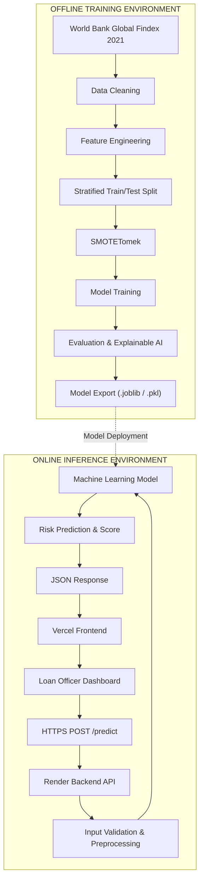

# 🇲🇦 Credit Risk Prediction for Micro-Loans in Morocco

### An End-to-End Machine Learning Pipeline for Alternative Credit Risk Assessment

<p align="center">
  <strong>Financial Inclusion · Machine Learning · Explainable AI · FinTech</strong>
</p>

---

## 📌 Table of Contents

1. [Project Overview](#-project-overview)
2. [Project Objectives](#-project-objectives)
3. [Authors & Academic Context](#-authors--academic-context)
4. [System Architecture](#-system-architecture)
5. [Dataset & Feature Engineering](#-dataset--feature-engineering)
6. [Machine Learning Methodology](#-machine-learning-methodology)
7. [Model Evaluation & Results](#-model-evaluation--results)
8. [Explainable AI & Feature Importance](#-explainable-ai--feature-importance)
9. [Web Application & API](#-web-application--api)
10. [Installation & Local Setup](#-installation--local-setup)
11. [Repository Structure](#-repository-structure)
12. [Ethics, Transparency & Limitations](#-ethics-transparency--limitations)
13. [Future Improvements](#-future-improvements)
14. [Technologies Used](#-technologies-used)
15. [License & Citation](#-license--citation)

---

## 🌍 Project Overview

Access to financial services remains a challenge for many individuals and small-scale entrepreneurs in developing economies, including Morocco.

Traditional credit scoring systems often rely on formal credit histories, banking records, and conventional financial indicators. Consequently, individuals with limited or no formal credit history (known as **thin-file borrowers**) may face difficulties accessing microfinance services.

This project explores an alternative approach to credit risk assessment using machine learning and alternative financial indicators.

Using the **World Bank Global Financial Inclusion (Global Findex) 2021 Dataset**, we developed an end-to-end machine learning pipeline to classify micro-loan applicants into two risk categories:

* **Low Risk (0):** Applicants classified as having lower financial vulnerability.
* **High Risk (1):** Applicants classified as having higher financial vulnerability.

The proposed system considers socio-economic characteristics, financial inclusion indicators, digital payment adoption, and income-related information.

The project integrates:

* Data cleaning and feature engineering.
* Supervised machine learning.
* Imbalanced classification using SMOTETomek.
* Model comparison and evaluation.
* Explainable AI (XAI).
* A REST API for real-time predictions.
* An interactive web application for loan risk assessment.

> **Important:** This project is an academic proof of concept. Its predictions are experimental risk indicators, not validated estimates of actual loan default probability or recommendations for real lending decisions.

---

## 🎯 Project Objectives

The main objectives are to:

1. Explore alternative financial indicators for assessing credit risk.
2. Investigate machine learning techniques for micro-loan risk classification.
3. Address class imbalance in financial datasets.
4. Compare Logistic Regression, Random Forest, and XGBoost.
5. Evaluate models using metrics suitable for imbalanced classification.
6. Improve model transparency through feature importance and explainability.
7. Develop a web-based interface connected to a deployed prediction API.
8. Explore the potential contribution of AI to financial inclusion in Morocco.

---

## 👥 Authors & Academic Context

| Information     | Details                                            |
| --------------- | -------------------------------------------------- |
| Authors         | Douae Laanaya, Ghoufrane Aamoumour, Noha Lakhmarti |
| Institution     | Al Akhawayn University in Ifrane (AUI)             |
| School          | School of Science and Engineering (SSE)            |
| Course          | CSC 3347 – Machine Learning and Data Mining        |
| Academic Year   | Fall 2025                                          |
| Submission Date | December 12, 2025                                  |

---

## 🏗 System Architecture

The system follows a decoupled architecture consisting of two main environments:

1. **Offline Training Environment:** Responsible for data preparation, feature engineering, model training, evaluation, and model export.
2. **Online Inference Environment:** Responsible for receiving applicant information, preprocessing input data, generating predictions, and returning risk assessments.

### Architecture Diagram



### Operational Workflow

1. **Applicant Information:** A loan officer enters applicant characteristics through the web application.
2. **API Communication:** The frontend sends the information to the backend using an HTTPS POST request.
3. **Data Processing:** The backend validates and transforms the input using the same preprocessing logic used during model development.
4. **Prediction:** The trained model generates a classification and associated model score.
5. **Results:** The API returns the prediction, risk category, and score in JSON format.
6. **Monitoring:** Prediction records can support future auditing, model monitoring, and fairness analysis if appropriate logging is implemented.

---

## 📊 Dataset & Feature Engineering

### 1. Dataset Source

The project uses the:

**World Bank – Global Financial Inclusion (Global Findex) Database 2021**

* Geographic scope: Morocco.
* Initial sample size: 1,000 survey respondents.
* Original attributes: 114.
* Selected modeling features: 22.

The dataset provides information about financial access, savings, borrowing, income, digital payments, and socio-economic characteristics.

### 2. Target Variable Engineering

We formulated a binary target variable named `risk_label` to identify a specific financial vulnerability profile.

An applicant is classified as High Risk when all three conditions are satisfied:

* Borrowed during the last year.
* Did not save during the last year.
* Has zero recorded income sources.

**Target definition:**

```python
df_clean['risk_label'] = 0

df_clean.loc[
    (df_clean['borrowed_last_year'] == 1) &
    (df_clean['saved_last_year'] == 0) &
    (df_clean['num_income_sources'] == 0),
    'risk_label'
] = 1
```

**Class Distribution**

| Risk Category | Label |   Samples | Percentage |
| ------------- | ----: | --------: | ---------: |
| Low Risk      |     0 |       893 |      89.3% |
| High Risk     |     1 |       107 |      10.7% |
| **Total**     |       | **1,000** |   **100%** |

<details>
<summary><strong>Understanding the class imbalance</strong></summary>

The dataset contains approximately 8.35 low-risk observations for every high-risk observation.

This imbalance can cause conventional classifiers to favor the majority class, potentially reducing their ability to detect high-risk cases.

To address this challenge, SMOTETomek was applied exclusively to the training dataset.

</details>

### 3. Feature Engineering & Selection

The original dataset was reduced to a set of 22 modeling features.

The following table highlights the main features documented in the project:

| Category         | Feature               | Description                        |
| ---------------- | --------------------- | ---------------------------------- |
| Demographics     | `age`                 | Applicant's age                    |
| Demographics     | `gender`              | Gender indicator                   |
| Demographics     | `education_level`     | Education level (1–5)              |
| Demographics     | `worked_last_7_days`  | Recent employment activity         |
| Economic         | `income_quintile`     | Income category (1–5)              |
| Economic         | `account`             | Formal bank account ownership      |
| Economic         | `has_receive_wages`   | Receives employment wages          |
| Economic         | `has_remittances`     | Receives remittances               |
| Digital Activity | `anydigpayment`       | Uses digital payments              |
| Digital Activity | `merchantpay_dig`     | Makes digital merchant payments    |
| Digital Activity | `internetaccess`      | Has internet access                |
| Engineered       | `digital_activity`    | Aggregate digital payment activity |
| Engineered       | `financial_stability` | Composite financial indicator      |

Additional features were used in the modeling pipeline to reach the final feature set.

### 4. Engineered Indicators

Three important engineered indicators were developed:

**Digital Activity**

```python
df_clean['digital_activity'] = (
    df_clean['anydigpayment'] +
    df_clean['merchantpay_dig']
)
```

**Number of Income Sources**

Represents the number of recorded income streams.

**Financial Stability**

```python
df_clean['financial_stability'] = (
    df_clean['saved_last_year'] +
    df_clean['account'] +
    df_clean['num_income_sources']
)
```

### 5. Data Leakage Prevention

A critical consideration was preventing target leakage.

The following variables were excluded from the model's input features because they were directly involved in constructing the target:

* `borrowed_last_year`
* `saved_last_year`
* `num_income_sources`

**Note:** The composite `financial_stability` feature includes savings and income-source information. Although the raw target variables were removed, this engineered feature can still indirectly encode target information. Its use should therefore be audited carefully, and a stricter leakage-free feature set should be evaluated separately.

---

## 🤖 Machine Learning Methodology

Three supervised machine learning algorithms were implemented and benchmarked.

### 1. Logistic Regression

Used as the baseline classification model.

* L2 regularization.
* `C = 1.0`
* `max_iter = 1000`

### 2. Random Forest Classifier

An ensemble learning method combining multiple decision trees.

* `n_estimators = 100`
* `max_depth = 10`
* `random_state = 42`

### 3. XGBoost Classifier

A gradient-boosting algorithm that builds decision trees sequentially to improve predictive performance.

* `n_estimators = 100`
* `learning_rate = 0.1`
* `max_depth = 6`
* `eval_metric = 'logloss'`

### Handling Class Imbalance: SMOTETomek

We implemented **SMOTETomek**, a hybrid resampling technique combining:

* **SMOTE:** Generates synthetic minority-class observations.
* **Tomek Links:** Removes selected borderline observations to improve class separation.

### Train/Test Split

A stratified 80/20 split was used to preserve the original class distribution.

| Dataset                | Low Risk | High Risk | Total |
| ---------------------- | -------: | --------: | ----: |
| Raw Training Set       |      714 |        86 |   800 |
| Resampled Training Set |      714 |       714 | 1,428 |
| Hold-Out Test Set      |      179 |        21 |   200 |

**Important methodological decisions:**

* The test set was separated before resampling.
* SMOTETomek was applied only to the training data.
* The test set retained its original class distribution.
* Model performance was evaluated on unseen test observations.

---

## 📈 Model Evaluation & Results

All models were evaluated using the unseen hold-out test set containing 200 observations.

We selected five metrics to provide a more complete assessment of classification performance.

### Performance Comparison

| Model               |  Accuracy | Balanced Accuracy |  F1-Score |   ROC-AUC |    PR-AUC |
| ------------------- | --------: | ----------------: | --------: | --------: | --------: |
| Logistic Regression | **0.895** |             0.794 | **0.571** | **0.940** |     0.567 |
| Random Forest       |     0.850 |         **0.874** |     0.559 |     0.914 |     0.467 |
| XGBoost             |     0.880 |             0.786 |     0.538 |     0.928 | **0.575** |

### Key Findings

**Logistic Regression**

* Highest accuracy: 89.5%.
* Highest ROC-AUC: 0.940.
* Highest F1-score: 0.571.

**Random Forest**

* Highest balanced accuracy: 87.4%.
* Demonstrated the strongest balance between sensitivity across the two classes according to this metric.

**XGBoost**

* Highest PR-AUC: 0.575.
* Demonstrated the strongest precision-recall ranking performance among the tested models.

### Model Selection

No single model achieved the best result across every evaluation metric.

The results suggest different strengths depending on the evaluation objective:

* Logistic Regression: Overall ranking performance.
* Random Forest: Balanced classification performance.
* XGBoost: Precision-recall performance.

For a financial risk application, model selection should prioritize the cost of false negatives and false positives rather than accuracy alone.

---

## 🔍 Explainable AI & Feature Importance

Interpretability is particularly important in financial decision-support systems.

To investigate the factors influencing model predictions, we examined feature importance from the tree-based models.

### Top Predictive Features

| Rank | Feature               | Description                       |
| ---- | --------------------- | --------------------------------- |
| 1    | `financial_stability` | Composite financial indicator     |
| 2    | `account`             | Bank account ownership            |
| 3    | `has_remittances`     | Remittance income                 |
| 4    | `merchantpay_dig`     | Digital merchant payment adoption |

These indicators suggest that financial access, income diversification, and digital financial activity may contain useful information for distinguishing the target classes.

**Interpretability considerations:**

* Feature importance indicates predictive contribution, not causality.
* Correlated features can distort importance rankings.
* SHAP values can provide more detailed local and global explanations.
* Sensitive demographic variables require additional fairness analysis.

---

## 🌐 Web Application & API

The project includes a web interface connected to a deployed machine learning backend.

### Application Architecture

| Component     | Technology             | Responsibility          |
| ------------- | ---------------------- | ----------------------- |
| Frontend      | Vercel                 | Web application hosting |
| Backend       | Render                 | API hosting             |
| API Framework | FastAPI / Flask        | Prediction endpoint     |
| ML Models     | Scikit-learn / XGBoost | Risk classification     |
| Serialization | Joblib / Pickle        | Model persistence       |

### Prediction Endpoint

`POST /predict`

The endpoint receives applicant information and returns a classification result.

#### Example Request

```json
{
  "age": 34,
  "gender": 2,
  "education_level": 3,
  "worked_last_7_days": 1,
  "income_quintile": 4,
  "account": 1,
  "anydigpayment": 1,
  "merchantpay_dig": 1,
  "internetaccess": 1,
  "has_receive_wages": 1,
  "has_receive_transfers": 0,
  "has_remittances": 1
}
```

#### Example Response

```json
{
  "status": "success",
  "prediction": 0,
  "risk_group": "Low Risk",
  "probability_score": 0.1245,
  "decision_confidence": "87.55%",
  "timestamp": "2025-12-12T14:32:10Z"
}
```

*The request and response above illustrate the documented API contract. Actual field names, validation rules, and response values must match the deployed implementation.*

---

## ⚙️ Installation & Local Setup

### Prerequisites

* Python 3.9–3.11 (depending on dependency compatibility).
* Git.
* pip.
* Virtual environment support.

### 1. Clone the Repository

```bash
git clone https://github.com/your-username/credit-risk-morocco.git

cd credit-risk-morocco
```

### 2. Create a Virtual Environment

**Windows:**

```bash
python -m venv venv

venv\Scripts\activate
```

**Linux / macOS:**

```bash
python3 -m venv venv

source venv/bin/activate
```

### 3. Install Dependencies

```bash
pip install --upgrade pip

pip install -r requirements.txt
```

### 4. Run the Machine Learning Notebook

```bash
jupyter notebook notebooks/ML_Project_Report.ipynb
```

The notebook contains the experimentation and model development workflow.

### 5. Launch the Backend API

```bash
cd api

python app.py
```

The expected local address depends on the API configuration:

* Flask default: `http://127.0.0.1:5000`
* FastAPI/Uvicorn default: `http://127.0.0.1:8000`

For FastAPI, if the application exposes an `app` object:

```bash
uvicorn app:app --reload --host 127.0.0.1 --port 8000
```

---

## 📂 Repository Structure

```text
credit-risk-morocco/
│
├── data/
│   ├── raw/
│   │   └── microfinance_morocco_findex2021.csv
│   │
│   └── processed/
│       └── cleaned_features.csv
│
├── notebooks/
│   └── ML_Project_Report.ipynb
│
├── models/
│   ├── logistic_regression_model.pkl
│   ├── xgboost_model.pkl
│   └── scaler.pkl
│
├── api/
│   ├── app.py
│   ├── preprocessing_utils.py
│   └── requirements.txt
│
├── frontend/
│   ├── index.html
│   ├── styles.css
│   └── app.js
│
├── docs/
│   └── ML_Project_Report.pdf
│
├── .gitignore
├── LICENSE
├── requirements.txt
└── README.md
```

---

## ⚖️ Ethics, Transparency & Limitations

The development of alternative credit scoring systems raises important ethical and technical considerations.

### Privacy & Data Protection

* Avoid collecting unnecessary personal information.
* Protect applicant data through appropriate security controls.
* Follow applicable data protection requirements, including Morocco's Law 09-08 and relevant CNDP guidance.

### Bias & Fairness

Demographic and socio-economic characteristics can introduce unfair discrimination.

The project identifies the need to monitor:

* Gender-related differences.
* Age-related differences.
* Income-group disparities.
* False-positive and false-negative rates across demographic groups.

### Explainability

Predictions should be interpretable and understandable to the people responsible for reviewing applications.

### Important Research Limitations

1. **Target validity:** The engineered label represents a financial vulnerability profile, not verified historical loan default.
2. **Dataset size:** The Morocco subset contains only 1,000 respondents.
3. **Representativeness:** Survey respondents are not necessarily representative of actual micro-loan applicants.
4. **Temporal limitations:** The dataset is from 2021 and may not capture current financial behavior.
5. **Probability calibration:** Predicted scores should not be interpreted as real-world default probabilities without validation and calibration.
6. **External validation:** Further testing on actual repayment outcomes is necessary before any operational lending use.

---

## 🚀 Future Improvements

Potential future extensions include:

* [ ] Integrate real microfinance repayment datasets.
* [ ] Validate the target against actual loan default outcomes.
* [ ] Perform external validation on independent Moroccan datasets.
* [ ] Implement SHAP-based individual prediction explanations.
* [ ] Add probability calibration and decision-threshold optimization.
* [ ] Conduct demographic fairness and bias audits.
* [ ] Develop model monitoring and data drift detection.
* [ ] Improve API authentication and access control.
* [ ] Add applicant history and prediction audit logs.
* [ ] Explore more advanced models and ensemble approaches.

---

## 🛠 Technologies Used

| Category             | Technologies                  |
| -------------------- | ----------------------------- |
| Programming Language | Python                        |
| Data Manipulation    | Pandas, NumPy                 |
| Data Visualization   | Matplotlib, Seaborn           |
| Machine Learning     | Scikit-learn                  |
| Gradient Boosting    | XGBoost                       |
| Imbalanced Learning  | Imbalanced-learn, SMOTETomek  |
| Explainable AI       | Feature Importance, SHAP      |
| Model Persistence    | Joblib, Pickle                |
| Backend              | FastAPI / Flask               |
| Frontend             | HTML, CSS, JavaScript         |
| Deployment           | Render, Vercel                |
| Development          | Jupyter Notebook, Git, GitHub |

---

## 📜 License

This project is distributed under the **MIT License**.

See the [`LICENSE`](LICENSE) file for more information.

---

## 📚 Dataset & Academic Citation

**Dataset:**

World Bank. (2021). *The Global Findex Database 2021: Financial Inclusion, Digital Payments, and Resilience in the Age of COVID-19.*

https://www.worldbank.org/en/publication/globalfindex

**Academic Project Citation:**

```bibtex
@article{Laanaya2025CreditRisk,
  title={Credit Risk Prediction for Micro-Loans in Morocco using Alternative Financial Data},
  author={Laanaya, Douae and Aamoumour, Ghoufrane and Lakhmarti, Noha},
  journal={School of Science and Engineering, Al Akhawayn University},
  year={2025}
}
```

---

<p align="center">
  <strong>🇲🇦 Exploring the Potential of AI for Financial Inclusion in Morocco</strong>
  <br/>
  <sub>Academic Machine Learning Project · Al Akhawayn University · Fall 2025</sub>
</p>
